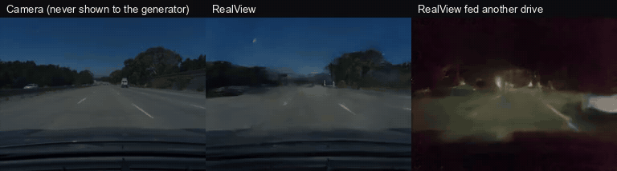
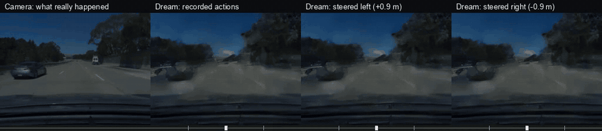
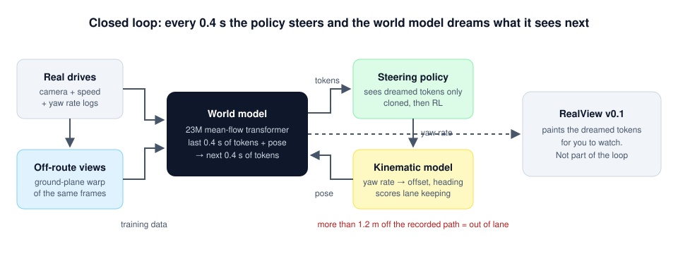
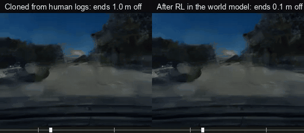
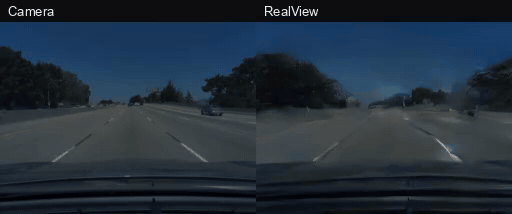
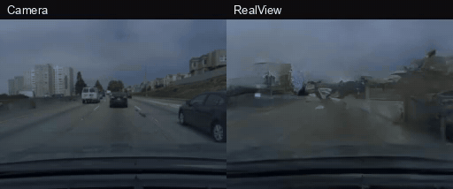
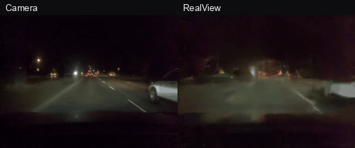
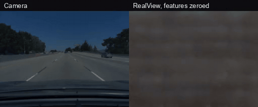
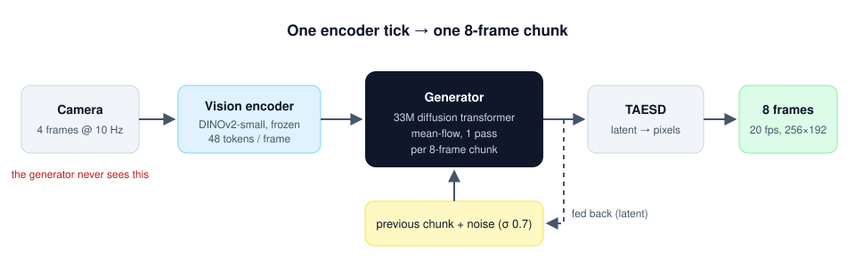

<div align="center">

<h1>RealView</h1>

<h3>일론 머스크가 공개한 테슬라 차량 화면(Reality View) 구조를 그대로 코드로 만들었습니다.<br>이제 조향할 수 있고, 그 안에서 주행 정책을 학습시킬 수 있는 월드모델이 붙었습니다.<br>코드와 가중치를 모두 공개하고, 전부 맥북 한 대로 학습했습니다.</h3>

<p>
<a href="#빠른-시작"></a>
<a href="https://github.com/azet-llc/realview/releases/tag/v0.2.0"></a>
</p>

<p><a href="README.md">English</a> | <b>한국어</b></p>



<sub>왼쪽: 카메라. 가운데: 인코더 특징값만 보고 같은 도로를 그린 RealView. 오른쪽: 같은 모델에 밤 주행의 특징값을 넣은 결과. 두 주행 모두 학습에 쓰지 않았습니다.</sub>

</div>

<br>

| 그 주행의 특징값을 줬을 때 | 다른 주행의 특징값을 줬을 때 | M4 Max 속도 | 모델 |
|---|---|---|---|
| 학습에 없던 주행에서 같은 순간을 **63.8%** 맞힘 | **1.5%** (무작위 2%) | 초당 **86프레임**, 8프레임마다 계산 한 번 | **3,300만** 파라미터, 66 MB |

**v0.2에서 추가: 그 위에 얹은 월드모델.**

| 기록된 경로 밖으로 조향하면 | 사람 로그를 모방한 정책 | 같은 정책을 꿈 안에서 강화학습(라벨 없음) | 사람이 쓴 라벨로 학습한 기준선(월드모델 없음) |
|---|---|---|---|
| 꿈 속 옆 거리가 운동학 모델을 **r = 0.93~0.99**로 따라감 | 20초 꿈의 **75%**에서 차선 이탈(사람은 경로를 벗어난 적이 없어 보정을 배우지 못함) | **0%**, **100%** 경로로 복귀 | 0%, 93% 복귀 |

월드모델은 2,300만 파라미터, 46 MB이고 같은 맥북에서 75분 학습했습니다.

## 소식

- **2026-11-28** v0.2.0 공개: v0.1 위에 [월드모델](#월드모델)을 얹었습니다. 꿈을 기록된 경로 밖으로 조향하고, 그 안에서 정책을 주행시키고, 꿈 안에서 강화학습으로 학습시킵니다. 가중치·정책·수치, 그리고 월드모델 없이도 되는 기준선까지 포함.
- **2026-11-27** v0.1.0 공개: 코드, 가중치(step 10,000 EMA), 학습에 쓰지 않은 60초 샘플 주행, 아래 수치 전부.
- **2026-11-22** 일론 머스크가 차량 화면을 만드는 방법을 [공개](https://x.com/elonmusk/status/2124458557525397780).

## 무엇인가

가운데 화면을 그리는 생성 모델은 카메라 화면을 보지 않습니다. 고정된 비전 인코더(DINOv2)가 그 프레임에서 뽑은 특징값과,
자기가 직전에 그린 화면만 받습니다. 그것만으로 도로를 다시 그립니다.

머스크의 글은 짧고 구체적입니다. 비전 인코더 특징값 → 별도의 확산 모델이 직전 생성 화면에 노이즈를 섞어 디노이즈 →
인코더 한 번에 8프레임 묶음. 이걸 `git clone` 해서 바로 돌릴 수 있는 저장소로 만들었습니다.

> 비공식 구현입니다. 테슬라와 관계가 없고, 테슬라의 코드·데이터·가중치를 쓰지 않았습니다.

## 빠른 시작

```sh
git clone https://github.com/azet-llc/realview && cd realview
pip install -r requirements.txt
sh scripts/download_weights.sh     # 생성 모델, 월드모델, 정책, TAESD(MIT), 60초 샘플 주행을 v0.2.0 릴리스에서 받음
python -m realview.run --video weights/sample_day.mp4 --out out.mp4
```

`out.mp4` 왼쪽은 카메라, 오른쪽은 RealView입니다. 내 블랙박스 영상(전방)을 넣어도 됩니다. 4:3으로 가운데를 자르고
256×192, 20 fps로 맞춥니다. 장치는 CUDA → Apple MPS → CPU 순서로 자동 선택합니다. MPS와 CPU에서 확인했고
(M4 Max CPU로 60초 샘플이 5분 15초), CUDA는 아직 확인하지 않았습니다.

```sh
python -m realview.run --video a.mp4 --feats zero              # 특징값을 0으로
python -m realview.run --video a.mp4 --feats shuffle:b.mp4     # 다른 주행의 특징값을 보여 줌
```

돌아갔다면 Star를 눌러 주세요. 다음에 공개로 만들 것(다중 카메라 입력, 위에서 내려다본 지도 화면, 경로대로 도로가 휘는 꿈)을 정하는 데 씁니다.

## 월드모델

v0.1은 카메라가 본 것을 그립니다. v0.2는 나머지 절반을 더했습니다. 로그에 없던 방향으로 차를 몰았을 때 카메라가 **보게 될** 장면을 예측하는 모델입니다.
그 안에서 주행 정책을 학습시키고 채점할 수 있습니다.

따라간 공개 자료는 샤오미의 [Auto World Model 2.0 보고서](https://arxiv.org/abs/2611.01677)([프로젝트 페이지](https://xiaomiautoworldmodel.github.io/CausalWorldModel/), 2026년 11월)입니다.
카메라·행동·레이아웃 조건으로 묶음 단위로 생성하는 인과적 월드모델을 폐루프 시뮬레이션과 폐루프 학습에 쓴다는 내용입니다.
같은 고리를 노트북 크기로 만들었고, 아래 수치는 모두 학습에서 뺀 두 주행에서 쟀습니다.

<p align="center"></p>

<sub>왼쪽은 카메라, 나머지 셋은 꿈입니다. 실제 화면 2.4초 뒤로는 카메라에서 아무것도 받지 않습니다. 같은 시작에 조향만 세 가지로 다릅니다.
아래 막대는 기록된 경로에서 벗어난 거리, 눈금은 차선 한계 1.2 m입니다.</sub>

<p align="center"></p>

| 샤오미 보고서 | RealView v0.2 |
|---|---|
| 묶음 단위로 생성하는 "스트리밍 인과적 월드모델" | 직전 0.4초 인코더 토큰에서 다음 0.4초 토큰을 예측하는 2,300만 파라미터 트랜스포머(v0.1 구조, 8블록). 화면은 v0.1이 그림 |
| "카메라·행동·레이아웃 조건" | 조건 = 차의 위치. 조향을 2상태 운동학 모델에 넣어 얻은, 기록된 경로 대비 옆 거리와 방향 오차. 여기에 속도와 경로의 회전 속도 |
| "폐루프 시뮬레이션" | 조향 정책이 0.4초마다 꿈의 두 프레임을 읽고 경로 회전 속도를 보정. 차선 유지는 운동학 모델이 채점 |
| "폐루프 학습"(E2E-WM-RL) | 꿈 안에서 PPO. 학습 주행만 사용, 보상은 운동학 상태에서. 정답 라벨도 복귀 규칙도 없음 |
| 1,260만 클립, 카메라 1~7대, 차와 로봇 | 1분 클립 56개, 카메라 1대, 차 1대. 로봇 없음 |
| (보고서에 없는, 우리가 더한 부분) 차가 실제로 가지 않은 시점 | 로그는 차선을 벗어나지 않습니다. 각 프레임을 지면 기준으로 워프해 가상의 이탈 궤적을 만들고 두 버전으로 학습 |

> 비공식 구현입니다. 샤오미와 관계가 없고, 샤오미의 코드·데이터·가중치를 쓰지 않았습니다.

### 꿈이 조향한 대로 가는가

인코더 토큰에서 차의 옆 거리를 읽는 작은 판독기를 씁니다. 시험 주행의 실제 워프 프레임에서 오차 0.09 m(r = 0.97)라 이걸 자로 삼았습니다.
그다음 기록된 경로 위에서 꿈 104개를 시작해, 로그에 없던 구불구불한 조향을 주고, 운동학 모델이 말하는 위치와 판독기가 꿈에서 읽은 위치를 비교했습니다.

| 꿈 시간 | 옆 거리: 꿈의 판독값 대 운동학 모델 | 평균 오차 |
|---|---|---|
| 0.4~2초 | r = **0.93** | 0.03 m |
| 2~4초 | r = **0.98** | 0.05 m |
| 4~8초 | r = **0.99** | 0.07 m |

실제 미래 토큰과의 오차(정규화 토큰 공간 MSE, 실제 이탈 시점에서 시작한 224회)는 3.2초 뒤 **0.373**으로, 직전 0.4초를 그대로 복사한 0.491보다 낮습니다.
위치 조건을 빼면 0.390, 다른 주행의 속도·경로를 주면 0.421입니다. 경로의 회전 속도를 0으로 바꿔도 0.374로 차이가 없습니다. 꿈이 기록된 경로만큼 도로를 휘게 그리지는 못한다는 뜻이라,
아래 정책에는 경로의 회전 속도를 직접 주고 「차선으로 돌아오는가」만 시험했습니다.

### 꿈 안의 강화학습이 실제로 통하는가

모든 에피소드는 시험 주행의 실제 이탈 프레임(기록된 경로에서 0.3~1.0 m, 평균 0.54 m)에서 시작해 꿈 안에서 20초 동안 달립니다. 105회.
정책은 경로의 회전 속도를 받고, 꿈의 두 프레임을 읽어 그 값을 보정합니다.
로그 속 사람은 경로를 벗어난 적이 없어서, 모방 정책이 배우는 보정값은 0입니다. 구조상 「보정 없음」과 같은 성적이 나옵니다.

| 정책 | 차선 이탈 | 20초 뒤 0.3 m 안으로 복귀 | 실제 화면에서의 보정 |
|---|---|---|---|
| 보정 없음(경로 그대로 재생) | 77.1% | 6.7% | |
| 사람 로그를 모방 | 75.2% | 7.6% | r = −0.07 |
| **모방 후 월드모델 안에서 강화학습** | **0%** | **100%** | r = **0.81** |
| 사람이 쓴 복귀 규칙으로 라벨을 붙여 모방(월드모델 없음) | 0% | 93.3% | r = 0.84 |
| 규칙 자체(실제 위치를 직접 읽음) | 0% | 100% | |

**실제 화면.** 시험 주행의 실제 워프 프레임 2,392장에서, 월드모델 없이, 각 정책의 보정값과 사람이 쓴 복귀 규칙의 상관을 쟀습니다.
강화학습 정책은 그 규칙도, 라벨도, 시험 주행의 프레임도 본 적이 없습니다. 학습 에피소드는 학습 주행의 실제 워프 프레임 한 장에서 시작해 그 뒤로는 꿈입니다. 꿈 안에서 PPO 150회(꿈 속 주행 최대 107시간, 노트북으로 약 40분)로 배웠습니다.

예상하지 못한 두 가지:

- 규칙 라벨 정책은 실제 프레임으로만 학습했는데 꿈에서도 한 번도 차선을 벗어나지 않았습니다. 꿈이 옆 거리를 실제 프레임과 같은 방식으로 보여 준다는 뜻입니다.
- 그 정책이 강화학습과 거의 같은 성적입니다. 이 과제에서 꿈 속 강화학습은 라벨을 없애 줬을 뿐, 라벨을 이기지는 못했습니다.

<p align="center"></p>

<sub>두 꿈 모두 기록된 경로 왼쪽 0.8 m에서 시작해 20초 동안 달립니다(2배속). 왼쪽: 모방 정책. 오른쪽: 강화학습 정책.</sub>

### 처음에 안 됐던 세 가지

- **샘플러가 발산했습니다.** 첫 월드모델은 v0.1 방식 그대로(mean-flow, 직전 묶음 + 노이즈)였습니다. 진단해 본 체크포인트 하나(2,000 스텝)에서
  토큰 분산이 첫 0.4초에 15% 커지고 그 뒤로 더 빨리 커졌습니다. 노이즈 크기를 바꿔도 같았고, 샘플링을 네 번으로 늘리면 증가가 절반쯤으로 줄었지만 멈추지는 않았습니다.
  v0.1은 매 묶음 실제 카메라 특징값이 붙잡아 주지만 꿈에는 그런 닻이 없기 때문이라고 봅니다. 더 오래 학습시켜 확인하지는 않았습니다. 공개한 모델은 네 묶음을 펼쳐 학습한 단순 회귀입니다.
- **위치 조건을 무시했습니다.** 위치는 묶음마다 몇 cm만 바뀌어서 직전 묶음을 베끼는 게 거의 공짜였습니다(조향한 꿈의 r 약 0.1).
  그래서 학습 샘플 절반은 같은 순간의 *다른* 버전(원본 또는 워프)에서 시작합니다. 위치가 뛰니 조건을 읽어야 맞출 수 있습니다. 조건을 각 프레임 토큰에 직접 더하는 경로도 넣었습니다.
  이 변경들과 회귀 전환은 한꺼번에 들어갔고, 하나씩 떼어 확인하지는 않았습니다.
- **화면만 보고 조향하는 과제는 실패했고, 원인을 가르지 못했습니다.** 초기 체크포인트에서, 커브를 보고 따라가야 하는 정책은 대부분의 꿈에서 차선을 벗어났습니다.
  실제 화면에서는 복귀 방향으로 조향하는 정책도 그랬습니다. 경로를 0으로 바꿔도 결과가 같다는 점은 꿈 쪽을 가리키지만, 그 정책들이 실제 프레임에서 커브를 얼마나 잘 따르는지는 재지 않아 두 원인을 분리하지 못했습니다.
  시험 주행에서 이걸 본 뒤 과제를 바꿨습니다.

### 실행

```sh
sh scripts/download_weights.sh     # 월드모델, 정책 3개, 샘플 주행의 속도·회전 로그도 함께 받음
python -m realview.dream --video weights/sample_day.mp4 --log weights/sample_day.npz --steer 0.02 --out dream.mp4
python -m realview.dream --video weights/sample_day.mp4 --log weights/sample_day.npz --offset 0.8 \
  --policy weights/policy_rl.pt --out back_in_lane.mp4
```

`--steer 0.02`는 차를 왼쪽으로 0.9 m쯤 밉니다. `--offset 0.8`은 경로에서 0.8 m 벗어난 곳에서 시작해 강화학습 정책이 되돌리게 합니다.
결과 영상은 왼쪽이 카메라, 오른쪽이 꿈입니다. 학습·평가 재현 방법은 [영문 README](README.md#world-model)에 있습니다.

## 갤러리

모두 학습에서 뺀 두 주행입니다. 빈 화면에서 시작한 실행의 4~12초 구간이며, 8프레임마다 계산 한 번입니다.

<table>
<tr>
<td align="center"><br><sub><b>낮 고속도로.</b> 이 클립은 100% 맞힘.</sub></td>
<td align="center"><br><sub><b>차가 많은 구간.</b> 65%. 가까운 차가 생겼다 사라집니다.</sub></td>
</tr>
<tr>
<td align="center"><br><sub><b>밤.</b> 이 클립 46%, 밤 주행 전체 26%. 가장 약한 부분.</sub></td>
<td align="center"><br><sub><b>특징값 0.</b> 같은 모델, 같은 시작인데 도로가 나타나지 않습니다.</sub></td>
</tr>
</table>

## 구조

<p align="center"></p>

| 머스크의 글 | RealView |
|---|---|
| 테슬라 범용 비전 인코더(UVE) 특징값 | 고정된 DINOv2-small(Apache-2.0). 16×12 패치 토큰을 8×6 = 프레임당 48토큰으로 |
| "UVE 특징값에서 갈라져 나옴" | 인코더 토큰을 두 번 넣음: 같은 위치의 8×6 잠재 패치에 더하고, in-context 토큰으로도 |
| "별도의 ~10억 파라미터 확산 모델" | 3,300만 파라미터 확산 트랜스포머(12블록, 폭 384). 같은 모양, 30분의 1 크기 |
| "조건부 mean-flow 모델" | Mean-flow 목표([Geng et al. 2025](https://arxiv.org/abs/2505.13447)), 묶음당 계산 한 번 |
| "직전 생성 화면에 노이즈를 더해 디노이즈" | 흐름의 출발점이 순수 노이즈가 아니라 직전 묶음 + 가우시안 노이즈(σ = 0.7). t = 1에서 0까지 한 번에 |
| UVE 18 Hz마다 "8장을 36 fps로" | 인코더 10 Hz 4프레임에서 20 fps 8프레임. 같은 2:1 비율을 comma 카메라 20 fps에 맞춤 |
| "UI 화면 해상도" | TAESD 오토인코더로 256×192 RGB(4×24×32 잠재) |

글에 없어서 우리가 정한 세 가지:

- **표류.** 자기 출력을 먹고 사는 모델은 점점 엇나갑니다. 학습 배치의 4분의 1은 "직전 묶음" 자리에 모델이 직접 그린 것을 넣고, 30%는 아무것도 없이 시작합니다.
- **위치 고정.** in-context 토큰만으로는 부족했습니다. 초기 학습에서 모델이 특징값을 무시하고 직전 화면만 베꼈습니다. 각 인코더 토큰을 같은 위치 패치에 더하자 해결됐습니다.
- **시간 임베딩.** Mean-flow는 t에 대해 네트워크를 미분합니다. DiT 관례인 `t × 1000`은 이 미분을 폭주시켜 첫 학습이 2,000 스텝에서 발산했습니다. t를 그대로 넣습니다.

## 측정 결과

공개한 `weights/realview.pt`(step 10,000, EMA)로, 학습에서 뺀 두 주행(낮 5클립, 밤 3클립, 각 59.6초)을 빈 화면에서부터 자기회귀로 돌려 쟀습니다.
`scripts/eval_rollout.py`, `scripts/val.py`로 재현할 수 있습니다. 생성한 0.4초 묶음마다 같은 클립에서 가장 가까운 실제 묶음을 찾아, 맞는 순간에서 0.4초 안인지 봅니다.

| 생성 모델 입력 | 같은 순간을 맞힌 비율 | PSNR |
|---|---|---|
| 그 주행의 특징값 | **63.8%** (낮 86.2%, 밤 26.4%) | **24.1 dB** |
| 다른 주행의 특징값 | 1.5% | 14.9 dB |
| 특징값 0 | 1.7% | 16.6 dB |
| 무작위 | 2.0% | |

M4 Max에서 8프레임 묶음당 92.6 ms(인코더·생성·디코더 포함, 학습과 GPU를 함께 쓰던 상태), 초당 86프레임입니다.
학습은 배치 16으로 1만 스텝, 같은 맥북에서 1시간 46분. 체크포인트와 노이즈 크기는 같은 시험 주행을 보며 골랐습니다.
나머지 수치와 학습 방법은 [영문 README](README.md#numbers)에 있습니다.

## 한계

- 차 한 대, 카메라 하나, 2018년 베이 에어리어 고속도로. 시내 도로와 다른 카메라에서는 더 나쁠 수 있습니다.
- 256×192라 작은 글씨, 먼 차선, 먼 차가 뭉개집니다.
- 앞차가 자주 사라지거나 뭉개지고, 표지판은 색 덩어리가 됩니다. 운전 판단에 쓸 수 없습니다.
- 밤은 낮보다 훨씬 약합니다(26% 대 86%).
- 노트북 한 대 몇 시간, 3,300만 파라미터입니다. 제품이 아니라 구조를 충실히 작게 재현한 것으로 봐 주세요.

월드모델:

- **이탈 시점은 복원이 아니라 워프입니다.** 지면은 맞게 움직이지만 그 위에 서 있는 것(차, 방호벽, 나무)은 틀리게 움직입니다. 판독기와 「실제 화면」 확인도 같은 워프로 쟀습니다.
- **차선 유지만 봅니다.** 고리 안에 다른 차가 없어 충돌은 재지 않습니다. 「차선 이탈」은 사람이 달린 경로에서 운동학 모델 기준 1.2 m 벗어난 것이고, 차선 인식이 아닙니다.
- **꿈은 경로대로 도로를 휘게 그리지 못합니다.** 그래서 정책에 경로의 회전 속도를 직접 줍니다.
- **꿈은 흐려집니다.** 회귀는 평균적인 미래를 예측합니다. 차선 도색은 몇 초 안에 옅어지고 차는 녹아 없어집니다.
- **향상은 정책을 학습시킨 그 시뮬레이터 안에서 잰 값입니다.** 실제 화면 확인은 워프 프레임에서의 상관계수입니다. 여기 있는 어떤 정책도 실제 차를 몰지 않았습니다.
- **시험 주행을 보며 다시 조정했습니다.** 과제 정의와 PPO 설정은 시험 주행 결과를 보면서 정했습니다.

## 라이선스

코드와 가중치는 Apache-2.0, © 2026 AZET LLC. 학습 데이터와 샘플 영상은 comma2k19(MIT, © comma.ai).
DINOv2(Apache-2.0, Meta), TAESD(MIT, © Ollin Boer Bohan). 질문과 내 블랙박스 실행 결과는
[Discussions](https://github.com/azet-llc/realview/discussions)에 올려 주세요.
