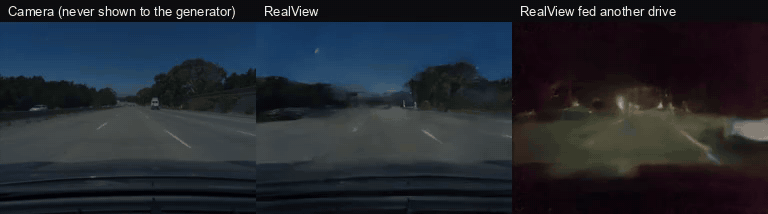
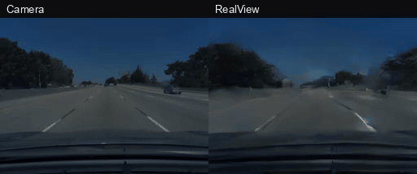
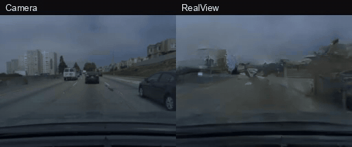
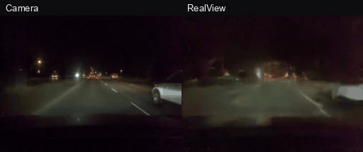
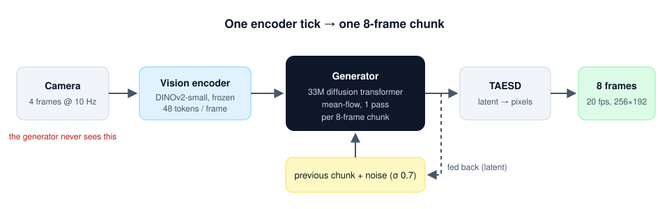

<div align="center">

<h1>RealView</h1>

<h3>Tesla's in-car Reality View, rebuilt from Elon's post.<br>Open code, open weights, trained on one MacBook in 1 h 46 min.</h3>

<p>
<a href="#quickstart"></a>
<a href="https://github.com/azet-llc/realview/releases/tag/v0.1.0"></a>
</p>

<p>
<a href="https://azet.io/products/realview"></a>
<a href="https://x.com/elonmusk/status/2124458557525397780"></a>
<a href="https://arxiv.org/abs/2505.13447"></a>
<a href="LICENSE"></a>

<a href="https://github.com/azet-llc/realview/discussions"></a>
</p>

<p><b>English</b> | <a href="README.ko.md">한국어</a></p>



<sub>Left: the camera. Middle: RealView paints the same road from encoder features only. Right: the same model fed a night drive's features. The model never trained on either drive.</sub>

</div>

<br>

| Shown the features of its own drive | Shown another drive's features | Speed on an M4 Max | Model |
|---|---|---|---|
| finds the right moment **63.8%** of the time, on drives it never trained on | **1.5%** (chance is 2%) | **86 fps** of output, one network pass per 8 frames | **33M** params, 66 MB |

## News

- **2026-11-27** v0.1.0: code, weights (step 10,000 EMA), a 60 s held-out sample drive and every number below.
- **2026-11-22** Elon Musk [posts](https://x.com/elonmusk/status/2124458557525397780) how the in-car Reality View is built.

## Contents

[What it is](#what-it-is) · [Quickstart](#quickstart) · [Gallery](#gallery) · [How it maps to the post](#how-it-maps-to-the-post) · [Numbers](#numbers) · [Train your own](#train-your-own) · [Limits](#limits) · [Citation](#citation)

## What it is

The generator never sees the camera. Per frame it gets 48 feature tokens from a frozen vision encoder, plus
its own previous output, and paints the road from that alone.

The post is public, short and specific ([source](https://x.com/elonmusk/status/2124458557525397780)):
vision-encoder features → a separate diffusion model that takes the previous generation with added
noise and denoises it into the current view → a small chunk of 8 frames per encoder tick. We built it as
a repo you can `git clone`.

> Unofficial. Not affiliated with or endorsed by Tesla. No Tesla code, data or weights are used.

## Quickstart

```sh
git clone https://github.com/azet-llc/realview && cd realview
pip install -r requirements.txt
sh scripts/download_weights.sh     # generator, TAESD (MIT) and a 60 s sample drive, from the v0.1.0 release
python -m realview.run --video weights/sample_day.mp4 --out out.mp4
```

`out.mp4` is the camera on the left and RealView on the right. The sample is a drive the model never trained on.
Swap in your own forward-facing dashcam clip.
It is center-cropped to 4:3, resized to 256×192 and resampled to 20 fps. The device is picked automatically
(CUDA, then Apple MPS, then CPU). We tested MPS and CPU: the 60 s sample takes 5 min 15 s end to end on the M4 Max CPU. CUDA is untested.
The ablations are one flag each:

```sh
python -m realview.run --video a.mp4 --feats zero              # blind it
python -m realview.run --video a.mp4 --feats shuffle:b.mp4     # show it a different drive
```

If it ran for you, a star helps. It tells us people want the next two pieces built in the open:
multi-camera input and a bird's-eye view target.

## Gallery

Every clip comes from the two drives held out of training. Each GIF shows seconds 4 to 12 of a run that starts from a blank screen, one network pass per 8 frames.

<table>
<tr>
<td align="center"><br><sub><b>Day highway.</b> Finds the right moment in 100% of this clip's chunks.</sub></td>
<td align="center"><br><sub><b>Traffic.</b> 65% on this clip. Nearby cars come and go.</sub></td>
</tr>
<tr>
<td align="center"><br><sub><b>Night.</b> 46% on this clip, 26% across the night drive. The weak spot.</sub></td>
<td align="center"><br><sub><b>Features set to zero.</b> Same model, same start, and the road never appears.</sub></td>
</tr>
</table>

## How it maps to the post

<p align="center"></p>

| The post | RealView |
|---|---|
| Tesla Universal Vision Encoder (UVE) features, the same ones the 3B driving model uses | Frozen DINOv2-small (Apache-2.0). 16×12 patch tokens pooled to 8×6 = 48 tokens per frame |
| "fork off from these UVE features" | Encoder tokens go in twice: added onto the matching 8×6 latent patch, and as in-context tokens |
| "a separate ~1B diffusion model" | A 33M-parameter diffusion transformer (12 blocks, width 384). Same shape, 30× smaller, laptop budget |
| "conditional mean-flow model" | Mean-flow objective ([Geng et al. 2025](https://arxiv.org/abs/2505.13447)), one network evaluation per chunk |
| "takes in the previous reality-view generation with added noise and then denoises it" | The flow's source is the previous chunk plus Gaussian noise (σ = 0.7), not pure noise. One step from t = 1 to 0 |
| "8 images at 36 fps" per UVE frame at 18 Hz | 8 frames at 20 fps from 4 encoder frames at 10 Hz. Same 2:1 ratio, rescaled to the comma camera's 20 fps. Our chunks follow one another without overlap; the post emits a chunk every encoder frame |
| "the resolution of the UI screen" | 256×192 RGB through the TAESD autoencoder (4×24×32 latents) |
| "~pixel-perfect world model … for synthetic data", the 3B driving model | Out of scope. This repo is only the in-car visualization path |

Three things the post does not say, which we had to decide:

- **Drift.** A model that feeds on its own output wanders off. During training, a quarter of the batches
  replace the "previous chunk" with the model's own generation, and 30% start from nothing at all. That
  second part forces the scene to come from the features.
- **Spatial grounding.** In-context tokens alone were not enough. In an early run the model ignored the
  features and copied its previous output. Adding each encoder token onto the patch at the same image position fixed it.
- **Time embedding.** Mean-flow differentiates the network with respect to t. The usual DiT `t × 1000`
  sinusoid makes that derivative explode (our first run diverged at step 2,000). We embed t unscaled.

## Numbers

All numbers come from the released `weights/realview.pt` (step 10,000, EMA). They were measured on the two drives held out of
training: 5 daytime clips and 3 night clips, 59.6 s each, run autoregressively from a blank start with one network pass per chunk.
Reproduce them with `scripts/eval_rollout.py` and `scripts/val.py`.

**Does it follow the road it is shown?** For every generated 0.4 s chunk, we look for the nearest real chunk of the same
clip (16×12 thumbnails) and check that it falls within 0.4 s of the right moment.

| Generator input | Tracks the real moment | PSNR vs. camera |
|---|---|---|
| Features of this drive | **63.8%** (day 86.2%, night 26.4%) | **24.1 dB** |
| Features of a different drive | 1.5% | 14.9 dB |
| Features set to zero | 1.7% | 16.6 dB |
| Chance | 2.0% | |
| Average frame of the clip (needs the whole future) | | 23.7 dB |
| TAESD round trip (the ceiling at this resolution, on the clips we checked) | | 32.5–34.3 dB |

**One step, held-out chunks.** Mean squared error in normalized latent space over 256 random held-out chunks.

| | MSE |
|---|---|
| RealView, previous chunk from the camera + features | **0.477** |
| Copy the previous chunk | 0.541 |
| RealView with features zeroed | 0.676 |
| RealView, cold start (features only) | 0.745 |
| Predict the dataset mean | 0.985 |

A two-layer MLP probe trained to regress latents from the same features reaches 0.484 on the held-out frames (`scripts/probe.py`).
That is the sharpest MSE number here because MSE rewards a blurry average. A sampler pays for drawing one specific scene instead.

**Speed.** 92.6 ms for one 8-frame chunk on an M4 Max, encoder, generator and decoder included, measured while
training shared the GPU. That is 86 fps of output against a 20 fps camera. **Training.** 10,000 steps of batch 16 in 1 h 46 min on the same laptop.

We chose the checkpoint and the noise level (σ = 0.7) while looking at these same held-out drives. A third,
untouched set of drives would be a cleaner test.

## Train your own

Data: the 64 one-minute clips of comma2k19's compression challenge (MIT, 21 drives, 76,778 frames).
We held out two whole drives, one by day and one at night, and trained on the other 19.

```sh
# 1. data (2.4 GB)
curl -L -o test_videos.zip "https://huggingface.co/datasets/commaai/comma2k19/resolve/main/compression_challenge/test_videos.zip"
unzip -q test_videos.zip -d videos
# 2. encoder tokens + VAE latents for every frame (12 min on an M4 Max)
python scripts/prep.py --videos videos --out data/prep --weights weights
# 3. train (resumes from runs/base/last.pt)
python scripts/train.py --data data/prep --out runs/base --steps 40000 \
  --holdout "2018-08-17--12-07-08,2018-08-10--22-42-26"
# 4. one-step error on the held-out drives vs. "copy the previous chunk"
python scripts/val.py --ckpt runs/base/last.pt
```

Fused attention on Apple's MPS backend has no forward-mode autodiff, and mean-flow needs a JVP. So
`realview/model.py` writes attention out by hand. On CUDA you can swap in `scaled_dot_product_attention`.

## Limits

- One car, one camera, one dongle, Bay Area highways in 2018. Expect worse on city streets and other cameras.
- 256×192. Small text, lane paint at distance and far cars smear.
- It drops and invents detail. Cars ahead often vanish or smear, and signs turn into colored blobs. A [summary of Tesla engineers'
  comments](https://x.com/Lidayou373514/status/2125780706513375399) names this as the hard part of shipping it. Nothing here is fit for any driving decision.
- Night is much weaker than day (26% vs. 86% tracking). 15 of the 19 training drives start between 06:00 and 17:00.
- 33M parameters on one laptop for hours, against Tesla's ~1B on a fleet. Treat it as a faithful small-scale
  reproduction of the architecture, not of the product.

## Citation

```bibtex
@software{realview2026,
  title  = {RealView: an open implementation of the in-car Reality View recipe},
  author = {{AZET LLC}},
  year   = {2026},
  url    = {https://github.com/azet-llc/realview},
  version = {0.1.0}
}
```

## Credits and license

Code: Apache-2.0, © 2026 AZET LLC. Released weights: Apache-2.0, trained only on comma2k19 (MIT, © comma.ai).
The release's `sample_day.mp4` and the demo footage are held-out comma2k19 clips, MIT, © comma.ai.
DINOv2 (Apache-2.0, Meta) is downloaded from Hugging Face at runtime.
`third_party/taesd.py` and the TAESD weights are MIT, © Ollin Boer Bohan. The mean-flow objective follows Geng, Deng, Bai,
Kolter and He, *Mean Flows for One-step Generative Modeling* (2025).

Built at [AZET](https://azet.io). Questions and results on your own dashcam footage go in
[Discussions](https://github.com/azet-llc/realview/discussions).
