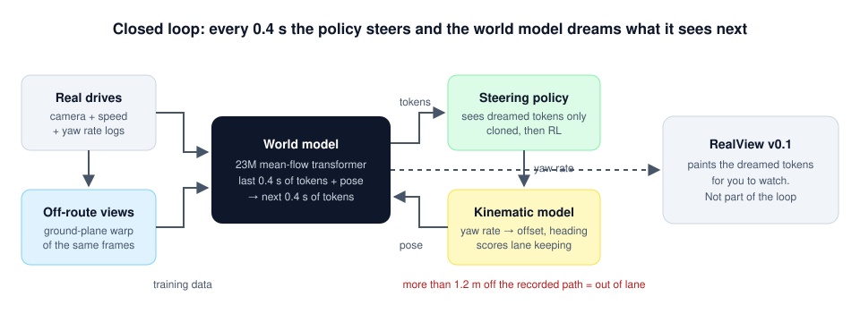
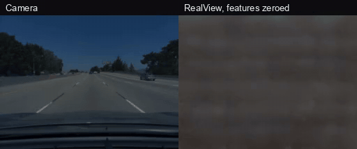

<div align="center">

<h1>RealView</h1>

<h3>Tesla's in-car Reality View, rebuilt from Elon's post.<br>Now with a world model you can steer and train a driving policy inside.<br>Open code, open weights, all of it trained on one MacBook.</h3>

<p>
<a href="#quickstart"></a>
<a href="https://github.com/azet-llc/realview/releases/tag/v0.2.0"></a>
</p>

<p>
<a href="https://azet.io/products/realview"></a>
<a href="https://x.com/elonmusk/status/2124458557525397780"></a>
<a href="https://arxiv.org/abs/2505.13447"></a>
<a href="https://arxiv.org/abs/2611.01677"></a>
<a href="LICENSE"></a>

<a href="https://x.com/azet_io"></a>
<a href="https://github.com/azet-llc/realview/discussions"></a>
</p>

<p><b>English</b> | <a href="README.ko.md">한국어</a></p>


<sub>Left: the camera. Middle: RealView paints the same road from encoder features only. Right: the same model fed a night drive's features. The model never trained on either drive.</sub>

</div>

<br>

| Shown the features of its own drive | Shown another drive's features | Speed on an M4 Max | Model |
|---|---|---|---|
| finds the right moment **63.8%** of the time, on drives it never trained on | **1.5%** (chance is 2%) | **86 fps** of output, one network pass per 8 frames | **33M** params, 66 MB |

**New in v0.2: a world model on top of it.**

| Steered off the recorded path | Policy cloned from human logs | Same policy after RL inside the dream, no labels | Baseline with hand-written labels, no world model |
|---|---|---|---|
| the dream's offset follows the kinematic model at **r = 0.93 to 0.99** | leaves the lane in **75%** of 20 s dreams (it learns no correction: the human never left the path) | **0%**, and back on the path in **100%** | 0%, back in 93% |

The world model is 23M parameters, 46 MB, trained in 75 min on the same laptop.

## News

- **2026-11-28** v0.2.0: a [world model](#world-model) on top of v0.1. Steer the dream off the recorded path, drive a policy inside it, train that policy with RL in the dream. Weights, policies, every number and the baseline that needs no world model.
- **2026-11-27** v0.1.0: code, weights (step 10,000 EMA), a 60 s held-out sample drive and every number below.
- **2026-11-22** Elon Musk [posts](https://x.com/elonmusk/status/2124458557525397780) how the in-car Reality View is built.

## Contents

[What it is](#what-it-is) · [Quickstart](#quickstart) · [World model](#world-model) · [Gallery](#gallery) · [How it maps to the post](#how-it-maps-to-the-post) · [Numbers](#numbers) · [Train your own](#train-your-own) · [Limits](#limits) · [Citation](#citation)

## What it is

The generator never sees the camera. Per frame it gets 48 feature tokens from a frozen vision encoder, plus
its own previous output, and paints the road from that alone.

The post is public, short and specific ([source](https://x.com/elonmusk/status/2124458557525397780)):
vision-encoder features → a separate diffusion model that takes the previous generation with added
noise and denoises it into the current view → a small chunk of 8 frames per encoder tick. We built it as
a repo you can `git clone`.

> Unofficial. Not affiliated with or endorsed by Tesla. No Tesla code, data or weights are used.

## Quickstart

```sh
git clone https://github.com/azet-llc/realview && cd realview
pip install -r requirements.txt
sh scripts/download_weights.sh     # generator, world model, policies, TAESD (MIT) and a 60 s sample drive, from the v0.2.0 release
python -m realview.run --video weights/sample_day.mp4 --out out.mp4
```

`out.mp4` is the camera on the left and RealView on the right. The sample is a drive the model never trained on.
Swap in your own forward-facing dashcam clip.
It is center-cropped to 4:3, resized to 256×192 and resampled to 20 fps. The device is picked automatically
(CUDA, then Apple MPS, then CPU). We tested MPS and CPU: the 60 s sample takes 5 min 15 s end to end on the M4 Max CPU. CUDA is untested.
The ablations are one flag each:

```sh
python -m realview.run --video a.mp4 --feats zero              # blind it
python -m realview.run --video a.mp4 --feats shuffle:b.mp4     # show it a different drive
```

If it ran for you, a star helps. It tells us people want the next pieces built in the open:
multi-camera input, a bird's-eye view target, and a dream whose road bends with the route.

## World model

v0.1 paints what the camera saw. v0.2 adds the other half: a model that predicts what the camera **would** see
if the car were steered somewhere the logs never went, so a driving policy can be trained and scored inside it.

The public description we followed is Xiaomi's [Auto World Model 2.0 report](https://arxiv.org/abs/2611.01677)
([project page](https://xiaomiautoworldmodel.github.io/CausalWorldModel/), Nov 2026): a causal world model that generates
chunk by chunk under camera, action and layout control, used for closed-loop simulation and closed-loop training.
This is that loop at laptop scale. Every number below is measured on the two drives held out of training.

<p align="center"></p>

<sub>Left: the camera. The other three are dreams: after 2.4 s of real frames, nothing comes from the camera. Same start, three steering inputs.
The bar under each dream is the car's offset from the recorded path, and the ticks are the 1.2 m lane limit.</sub>

<p align="center"></p>

| Xiaomi's report | RealView v0.2 |
|---|---|
| "A unified streaming causal world model", generated per chunk | A 23M transformer (the v0.1 architecture, 8 blocks) that predicts the next 0.4 s of encoder tokens from the last 0.4 s. v0.1 paints them |
| "Camera, action and layout control" | Control is the car's pose: offset and heading relative to the recorded path, from a 2-state kinematic model driven by the steering. Plus speed and the route's yaw rate |
| Used for "closed-loop simulation" | A steering policy reads two dreamed frames every 0.4 s and corrects the route's yaw rate. The kinematic model scores lane keeping |
| Used for "closed-loop training" (their E2E-WM-RL) | PPO inside the dream, on training drives only. Reward comes from the kinematic state. No labels and no steer-back rule |
| 12.6M clips, 1 to 7 views, cars and robots | 56 one-minute clips, one camera, one car. No robots |
| (Our addition, not from the report) Views the car never drove | The logs never leave the lane. We warp each frame along its ground plane to a simulated off-route trajectory and train on both versions |

> Unofficial. Not affiliated with or endorsed by Xiaomi. No Xiaomi code, data or weights are used.

### Does the dream go where it is steered?

A small probe reads the car's offset from encoder tokens. On real warped frames of the held-out drives it is right to
0.09 m (r = 0.97), so we use it as the measuring stick. Then we start 104 dreams on the recorded path, steer each along a
wandering course the logs never contained, and compare where the kinematic model says the car is with where the probe sees it in the dream.

| Dream time | Offset: probe on the dream vs. kinematic model | Mean error |
|---|---|---|
| 0.4 to 2 s | r = **0.93** | 0.03 m |
| 2 to 4 s | r = **0.98** | 0.05 m |
| 4 to 8 s | r = **0.99** | 0.07 m |

**Against the real future.** From a real off-route start, dream forward and compare with the real (warped) tokens. Mean squared error in normalized token space, 224 starts.

| | 0.4 s | 0.8 s | 1.6 s | 3.2 s |
|---|---|---|---|---|
| World model, true pose | **0.168** | **0.221** | **0.288** | **0.373** |
| World model, pose withheld | 0.183 | 0.238 | 0.305 | 0.390 |
| World model, another drive's speed and route | 0.179 | 0.246 | 0.332 | 0.421 |
| World model, route yaw rate zeroed | 0.168 | 0.222 | 0.290 | 0.374 |
| Copy the last 0.4 s | 0.231 | 0.312 | 0.404 | 0.491 |

The last-but-one row is a failure we kept in the table: zeroing the route's yaw rate changes nothing, so the dream does not bend the
road the way the recorded route bends. The policy below is therefore handed the route's yaw rate and is only tested on getting back into its lane.

### Does RL inside the dream teach anything real?

Every episode starts from a real off-route frame of a held-out drive, 0.3 to 1.0 m beside the recorded path (0.54 m on average),
and runs for 20 s inside the dream. 105 episodes. The policy is handed the route's yaw rate and reads two dreamed frames to correct it.
The human in the logs never leaves the path, so the correction a cloned policy learns is zero. It scores like no correction at all, by construction.

| Policy | Left the lane | Back within 0.3 m at 20 s | Its correction on real pixels |
|---|---|---|---|
| No correction (replays the route) | 77.1% | 6.7% | |
| Cloned from the human logs | 75.2% | 7.6% | r = −0.07 |
| **Cloned, then RL inside the world model** | **0%** | **100%** | r = **0.81** |
| Cloned with a hand-written steer-back rule, no world model | 0% | 93.3% | r = 0.84 |
| The rule itself, reading the true pose | 0% | 100% | |

**Real pixels.** On 2,392 real warped frames of the held-out drives, with no world model in the loop, we correlate each policy's
correction with the hand-written steer-back rule. The RL policy never saw that rule, a label, or a frame of the held-out drives. Each of its training episodes
starts from 0.4 s of real warped frames of a training drive and is dreamed from there.
It got there from 150 PPO iterations in the dream (up to 107 hours of dreamed driving, about 40 min of laptop time).

Two things this table says that we did not expect:

- The rule-labelled policy was trained on real frames only, and it also stays in lane in every dream. So the dream shows an offset the way real frames do.
- That same policy does about as well as RL. On this task, RL in the dream removed the need for labels. It did not beat them.

<p align="center"></p>

<sub>Both dreams start 0.8 m left of the recorded path and run for 20 s (shown at 2× speed). Left: the cloned policy. Right: the RL policy.</sub>

### Three things that did not work first

- **A sampler diverged.** Our first world model was the v0.1 recipe in token space: mean-flow, previous chunk plus noise.
  On the one checkpoint we diagnosed (2,000 steps), token variance grew 15% in the first 0.4 s and faster after that, at every noise level we tried.
  Four sampling steps roughly halved the growth and did not stop it. Our reading is that v0.1 survives because real camera features
  re-anchor it every chunk, and a dream has no anchor. We did not train that version longer to find out. The released model is a plain regression unrolled over four chunks.
- **It ignored the pose.** The pose changes by centimetres per chunk, so copying the previous chunk was almost free and the control went unused
  (steered-dream r near 0.1). Now half the training samples start from the *other* version of the same moment, recorded or warped,
  so the pose jumps and the model has to read it. The control is also added onto each frame's tokens. These changes and the switch to
  regression went in together. We did not ablate them one by one.
- **Vision-only steering failed, and we could not tell why.** On an early checkpoint, a policy that had to see the curve and steer it left the lane
  in most dreams. So did one that steers back on real pixels. The zeroed-route row points at the dream, but we never measured how well those
  policies follow a curve on real frames, so the two causes are not separated. We changed the task after seeing this on the held-out drives.

### Run it

```sh
sh scripts/download_weights.sh     # also fetches the world model, three policies and the sample drive's log
python -m realview.dream --video weights/sample_day.mp4 --log weights/sample_day.npz --steer 0.02 --out dream.mp4
python -m realview.dream --video weights/sample_day.mp4 --log weights/sample_day.npz --offset 0.8 \
  --policy weights/policy_rl.pt --out back_in_lane.mp4
```

`--steer 0.02` nudges the car about 0.9 m to the left. `--offset 0.8` starts it 0.8 m off the path and lets the RL policy bring it back.
Each output is the camera on the left and the dream on the right. Your own clip needs an `.npz` with per-frame `speed` (m/s) and `yaw` (rad/s) at 20 fps. Without `--log` the car holds 30 m/s on a straight road.

## Gallery

Every clip comes from the two drives held out of training. Each GIF shows seconds 4 to 12 of a run that starts from a blank screen, one network pass per 8 frames.

<table>
<tr>
<td align="center"><br><sub><b>Day highway.</b> Finds the right moment in 100% of this clip's chunks.</sub></td>
<td align="center"><br><sub><b>Traffic.</b> 65% on this clip. Nearby cars come and go.</sub></td>
</tr>
<tr>
<td align="center"><br><sub><b>Night.</b> 46% on this clip, 26% across the night drive. The weak spot.</sub></td>
<td align="center"><br><sub><b>Features set to zero.</b> Same model, same start, and the road never appears.</sub></td>
</tr>
</table>

## How it maps to the post

<p align="center"></p>

| The post | RealView |
|---|---|
| Tesla Universal Vision Encoder (UVE) features, the same ones the 3B driving model uses | Frozen DINOv2-small (Apache-2.0). 16×12 patch tokens pooled to 8×6 = 48 tokens per frame |
| "fork off from these UVE features" | Encoder tokens go in twice: added onto the matching 8×6 latent patch, and as in-context tokens |
| "a separate ~1B diffusion model" | A 33M-parameter diffusion transformer (12 blocks, width 384). Same shape, 30× smaller, laptop budget |
| "conditional mean-flow model" | Mean-flow objective ([Geng et al. 2025](https://arxiv.org/abs/2505.13447)), one network evaluation per chunk |
| "takes in the previous reality-view generation with added noise and then denoises it" | The flow's source is the previous chunk plus Gaussian noise (σ = 0.7), not pure noise. One step from t = 1 to 0 |
| "8 images at 36 fps" per UVE frame at 18 Hz | 8 frames at 20 fps from 4 encoder frames at 10 Hz. Same 2:1 ratio, rescaled to the comma camera's 20 fps. Our chunks follow one another without overlap; the post emits a chunk every encoder frame |
| "the resolution of the UI screen" | 256×192 RGB through the TAESD autoencoder (4×24×32 latents) |
| "~pixel-perfect world model … for synthetic data", the 3B driving model | Not this model. v0.2 adds a small [world model](#world-model) of its own, built from Xiaomi's public report |

Three things the post does not say, which we had to decide:

- **Drift.** A model that feeds on its own output wanders off. During training, a quarter of the batches
  replace the "previous chunk" with the model's own generation, and 30% start from nothing at all. That
  second part forces the scene to come from the features.
- **Spatial grounding.** In-context tokens alone were not enough. In an early run the model ignored the
  features and copied its previous output. Adding each encoder token onto the patch at the same image position fixed it.
- **Time embedding.** Mean-flow differentiates the network with respect to t. The usual DiT `t × 1000`
  sinusoid makes that derivative explode (our first run diverged at step 2,000). We embed t unscaled.

## Numbers

All numbers come from the released `weights/realview.pt` (step 10,000, EMA). They were measured on the two drives held out of
training: 5 daytime clips and 3 night clips, 59.6 s each, run autoregressively from a blank start with one network pass per chunk.
Reproduce them with `scripts/eval_rollout.py` and `scripts/val.py`.

**Does it follow the road it is shown?** For every generated 0.4 s chunk, we look for the nearest real chunk of the same
clip (16×12 thumbnails) and check that it falls within 0.4 s of the right moment.

| Generator input | Tracks the real moment | PSNR vs. camera |
|---|---|---|
| Features of this drive | **63.8%** (day 86.2%, night 26.4%) | **24.1 dB** |
| Features of a different drive | 1.5% | 14.9 dB |
| Features set to zero | 1.7% | 16.6 dB |
| Chance | 2.0% | |
| Average frame of the clip (needs the whole future) | | 23.7 dB |
| TAESD round trip (the ceiling at this resolution, on the clips we checked) | | 32.5–34.3 dB |

**One step, held-out chunks.** Mean squared error in normalized latent space over 256 random held-out chunks.

| | MSE |
|---|---|
| RealView, previous chunk from the camera + features | **0.477** |
| Copy the previous chunk | 0.541 |
| RealView with features zeroed | 0.676 |
| RealView, cold start (features only) | 0.745 |
| Predict the dataset mean | 0.985 |

A two-layer MLP probe trained to regress latents from the same features reaches 0.484 on the held-out frames (`scripts/probe.py`).
That is the sharpest MSE number here because MSE rewards a blurry average. A sampler pays for drawing one specific scene instead.

**Speed.** 92.6 ms for one 8-frame chunk on an M4 Max, encoder, generator and decoder included, measured while
training shared the GPU. That is 86 fps of output against a 20 fps camera. **Training.** 10,000 steps of batch 16 in 1 h 46 min on the same laptop.

We chose the checkpoint and the noise level (σ = 0.7) while looking at these same held-out drives. A third,
untouched set of drives would be a cleaner test.

## Train your own

Data: the 64 one-minute clips of comma2k19's compression challenge (MIT, 21 drives, 76,778 frames).
We held out two whole drives, one by day and one at night, and trained on the other 19.

```sh
# 1. data (2.4 GB)
curl -L -o test_videos.zip "https://huggingface.co/datasets/commaai/comma2k19/resolve/main/compression_challenge/test_videos.zip"
unzip -q test_videos.zip -d videos
# 2. encoder tokens + VAE latents for every frame (12 min on an M4 Max)
python scripts/prep.py --videos videos --out data/prep --weights weights
# 3. train (resumes from runs/base/last.pt)
python scripts/train.py --data data/prep --out runs/base --steps 40000 \
  --holdout "2018-08-17--12-07-08,2018-08-10--22-42-26"
# 4. one-step error on the held-out drives vs. "copy the previous chunk"
python scripts/val.py --ckpt runs/base/last.pt
```

The world model, the policies and their numbers (after steps 1 and 2 above):

```sh
# 5. speed and yaw rate from the comma2k19 logs, plus encoder tokens of every frame warped off-route
#    (about 4 min as four parallel copies: add --shard 0/4 ... --shard 3/4)
mkdir logs && for i in 0 1 2; do curl -L -o logs/demo$i.parquet \
  "https://huggingface.co/datasets/commaai/comma2k19/resolve/main/data/demo-0000$i-of-00003.parquet"; done
python scripts/prep_world.py --videos videos --logs logs --out data/prep_world
# 6. world model (4,000 steps, 75 min on an M4 Max that was also running evaluations)
H="2018-08-17--12-07-08,2018-08-10--22-42-26"
python scripts/train_world.py --data data/prep --out runs/world --steps 4000 --holdout $H
python scripts/export.py runs/world/last.pt weights/realview_world.pt --which model
# 7. does it go where it is steered?
python scripts/world_eval.py --ckpt weights/realview_world.pt --holdout $H
# 8. policies: cloned, cloned with a steer-back rule, RL inside the dream. Then all three on the held-out drives
for m in bc aug ppo eval; do python scripts/closed_loop.py $m --world weights/realview_world.pt --holdout $H; done
```

Fused attention on Apple's MPS backend has no forward-mode autodiff, and mean-flow needs a JVP. So
`realview/model.py` writes attention out by hand. On CUDA you can swap in `scaled_dot_product_attention`.

## Limits

- One car, one camera, one dongle, Bay Area highways in 2018. Expect worse on city streets and other cameras.
- 256×192. Small text, lane paint at distance and far cars smear.
- It drops and invents detail. Cars ahead often vanish or smear, and signs turn into colored blobs. A [summary of Tesla engineers'
  comments](https://x.com/Lidayou373514/status/2125780706513375399) names this as the hard part of shipping it. Nothing here is fit for any driving decision.
- Night is much weaker than day (26% vs. 86% tracking). 15 of the 19 training drives start between 06:00 and 17:00.
- 33M parameters on one laptop for hours, against Tesla's ~1B on a fleet. Treat it as a faithful small-scale
  reproduction of the architecture, not of the product.

World model:

- **The off-route views are warps, not reconstructions.** A ground-plane shear moves the road correctly and everything
  that stands on it (cars, barriers, trees) incorrectly. The lane probe and the "real pixels" check are scored on those same warps.
- **Lane keeping only.** There are no other agents in the loop, so nothing here measures collisions. "Out of lane" means
  1.2 m from the path a human drove, by a kinematic model. It is not a lane detector.
- **The dream does not bend the road with the route** (the zeroed-route row), so the policy is handed the route's yaw rate.
- **Dreams blur.** A regression predicts the average future. Lane paint fades within a few seconds and cars dissolve.
- **The gain is measured in the simulator that trained the policy.** The check on real pixels is a correlation on warped frames. No policy here has driven a car.
- **We tuned on the held-out drives again**: the task definition and the PPO settings were chosen while looking at them.

## Citation

```bibtex
@software{realview2026,
  title  = {RealView: an open implementation of the in-car Reality View recipe},
  author = {{AZET LLC}},
  year   = {2026},
  url    = {https://github.com/azet-llc/realview},
  version = {0.2.0}
}
```

## Credits and license

Code: Apache-2.0, © 2026 AZET LLC. Released weights: Apache-2.0, trained only on comma2k19 (MIT, © comma.ai).
The release's `sample_day.mp4` and the demo footage are held-out comma2k19 clips, MIT, © comma.ai.
DINOv2 (Apache-2.0, Meta) is downloaded from Hugging Face at runtime.
`third_party/taesd.py` and the TAESD weights are MIT, © Ollin Boer Bohan. The mean-flow objective follows Geng, Deng, Bai,
Kolter and He, *Mean Flows for One-step Generative Modeling* (2025).
The world-model loop follows the public description in *Xiaomi Auto World Model 2.0: Causal World Models for Real-World Driving
and Embodied Intelligence* (Zhu et al., 2026). Speed and yaw rate come from the comma2k19 logs (MIT, © comma.ai).

Built at [AZET](https://azet.io). Questions and results on your own dashcam footage go in
[Discussions](https://github.com/azet-llc/realview/discussions).
